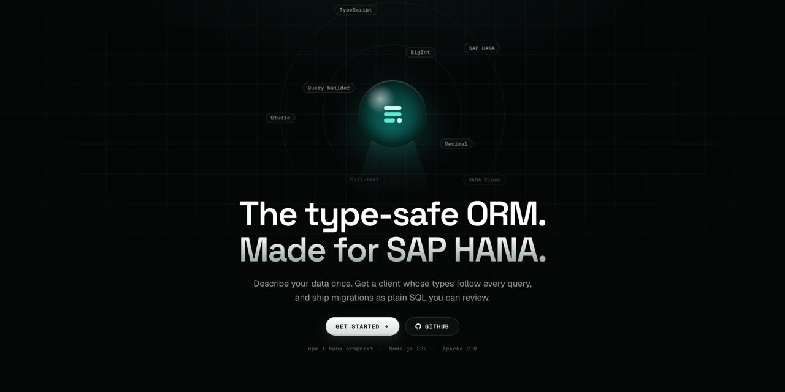

<div align="center">

<a href="https://tw4.github.io/hana-orm/"></a>

# hana-orm

**The type-safe TypeScript ORM for SAP HANA and HANA Cloud.**

Describe your data once in a schema, get a client whose types follow every query, and ship
migrations as plain SQL you can review.

[](https://www.npmjs.com/package/hana-orm)
[](https://www.npmjs.com/package/hana-orm)
[](https://github.com/tw4/hana-orm/actions/workflows/ci.yml)
[](LICENSE)
[](https://github.com/tw4/hana-orm/stargazers)

[**Documentation**](https://tw4.github.io/hana-orm/) ·
[Getting started](https://tw4.github.io/hana-orm/getting-started/) ·
[Coming from Prisma](https://tw4.github.io/hana-orm/guides/from-prisma/) ·
[Changelog](CHANGELOG.md)

</div>

---

```sh
npm install hana-orm @sap/hana-client
```

## Describe your data once

```prisma
// schema.hana
model User {
  id        Int      @id @default(autoincrement())
  email     String   @unique @db.NVarChar(320)
  name      String?
  createdAt DateTime @default(now())
  posts     Post[]
}

model Post {
  id       Int    @id @default(autoincrement())
  title    String
  authorId Int
  author   User   @relation(fields: [authorId], references: [id])

  @@index([authorId])
}
```

## Query with types that follow your query

```ts
import { HanaClient } from "./generated/hana/index.ts";

const db = new HanaClient();

const users = await db.user.findMany({
  where: { email: { endsWith: "@example.com" } },
  select: { email: true, posts: { select: { title: true }, take: 3 } },
  orderBy: { createdAt: "desc" },
});
// users: { email: string; posts: { title: string }[] }[]

await db.$transaction(async (tx) => {
  const ada = await tx.user.create({ data: { email: "ada@example.com" } });
  await tx.post.create({ data: { title: "Hello HANA", authorId: ada.id } });
});
```

## Ship migrations you can read

```sh
$ npx hana-orm migrate plan --name add_views
Created migration migrations/20261120101500_add_views with 2 operation(s):
  - Add column "views" to "Post"
  - Create index "IX_Post_views" on "Post" ("views")

$ npx hana-orm migrate deploy
Applying 20261120101500_add_views (2 operation(s))
Applied 1 migration(s).
```

Each migration is a folder with the literal HANA SQL that runs, applied in one transaction with
transactional DDL. Planning needs no database and no shadow database.

## Features

|  |  |
|---|---|
| **Schema** | Prisma-like `.hana` schema: models, relations (1-1, 1-n, many-to-many), enums, views, `@db.*` HANA types, indexes, full-text indexes, check constraints, sequences, comments. Or write it in TypeScript. |
| **Client** | Generated and fully typed: `findMany`, `include`, nested writes, `upsert`, `groupBy`, interactive and batch `$transaction`, `$extends` with computed fields. |
| **Query builder** | SQL-like and typed: `db.select().from(user).leftJoin(post, …)`, subqueries, `WITH`, prepared queries, `$batch`. |
| **Raw SQL** | Safe tagged templates, and typed functions generated from `.sql` files. |
| **Migrations** | `plan`, `deploy`, `status`, drift checks, renames, data migrations in TypeScript, squash and split, a deploy lock. |
| **Existing databases** | `db pull` reads your tables, keys and relations into a schema; `migrate baseline` takes it from there. |
| **HANA-native values** | `BIGINT` as `bigint`, `DECIMAL` without losing a digit (string, number or decimal.js), timestamps in UTC, Json filters. |
| **Tools** | `hana-orm studio` (a local data browser), a formatter, a VS Code extension, events and metrics. |
| **Runs anywhere Node does** | Pure TypeScript, no query engine binary. The only native piece is SAP's `@sap/hana-client`. SAP HANA 2.0, HANA Cloud and HANA Express. |

## Why hana-orm

|  | hana-orm | `@sap/hana-client` alone | Prisma |
|---|---|---|---|
| SAP HANA support | ✅ built for it | ✅ | ❌ no HANA connector |
| Typed results | ✅ follow `select` / `include` | ❌ | ✅ |
| Schema and migrations | ✅ plain SQL, no shadow DB | ❌ write DDL by hand | ✅ |
| Read an existing database | ✅ `db pull` | ❌ | ✅ |
| Exact `BIGINT` / `DECIMAL` | ✅ | ⚠️ convert yourself | ✅ |

Coming from another tool? See the guides for
[Prisma](https://tw4.github.io/hana-orm/guides/from-prisma/),
[TypeORM](https://tw4.github.io/hana-orm/guides/from-typeorm/) and the
[raw driver](https://tw4.github.io/hana-orm/guides/from-hana-client/).

## Quick start

```sh
npm install hana-orm @sap/hana-client
npx hana-orm init                       # schema.hana and .env.example
cp .env.example .env                    # fill in the HANA connection
npx hana-orm migrate plan --name init   # or `npx hana-orm db pull` for an existing database
npx hana-orm migrate deploy
npx hana-orm generate
```

Requires Node.js 22.12+. Continue with
[Getting started](https://tw4.github.io/hana-orm/getting-started/), or try it against a local
[HANA Express in Docker](https://tw4.github.io/hana-orm/guides/testing/).

## Status

hana-orm is a **release candidate for 1.0** (`1.0.0-rc.2`). The API is meant to be stable for
1.0; breaking changes until then are listed in the [changelog](CHANGELOG.md). Every release runs
its integration suite against SAP HANA Express. See the [roadmap](ROADMAP.md) for what comes
next.

## Support the project

If hana-orm saves you time, **[give it a ⭐ on GitHub](https://github.com/tw4/hana-orm)**: it
helps other SAP developers find it. Bug reports, ideas and pull requests are welcome too.

## Contributing

Read [CONTRIBUTING.md](CONTRIBUTING.md) for the development setup and the ground rules (no
private data in code, tests or issues), and open an issue before starting on a larger change.
Found a security problem? Please report it privately, see [SECURITY.md](SECURITY.md).

## License

[Apache License 2.0](LICENSE). SAP and SAP HANA are trademarks of SAP SE; hana-orm is an
independent project and is not affiliated with or endorsed by SAP.
